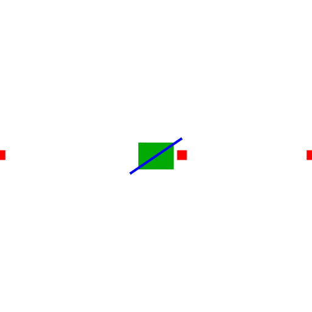

# Bounded source underzooming

Vector and raster sources can keep their native minimum-zoom tiles visible while the camera is zoomed out further:

```ts
map.addSource('roads', {
    type: 'vector',
    url: 'pmtiles://https://example.com/roads.pmtiles',
    underzoomLevels: 2
});
```

Register a PMTiles protocol handler before using a `pmtiles://` URL. The option also works with ordinary vector/raster tile URLs and inline sources in a style.

`underzoomLevels` accepts the integers **0–4** and defaults to **0**, preserving the normal minimum-zoom cutoff. A source with minimum zoom 8 and `underzoomLevels: 2` selects native zoom-8 tiles at tile-covering zooms 6 and 7. It selects no tiles below that range. Tile size and raster zoom rounding follow normal source tile-selection rules. Style-layer `minzoom` and `maxzoom` remain independent visibility limits. Overzooming above a source's maximum is unchanged.

Underzooming selects and renders the existing native tiles at their geographic coordinates. It does not synthesize parent tiles, alter tile IDs, or rewrite archives. Source options survive style serialization and reloading.

Each additional underzoom level can multiply the native tile count by four. Source `bounds` reduce the actual tile requests, but are applied after visible tiles have been selected. Keep the limit small, especially for dense or geographically broad sources. Values are still bounded at runtime when style validation is disabled.

Vector layout continues to use the native tile zoom. Zoom-dependent symbol layout, label density and collisions may therefore differ from a tileset generated specifically for overview zooms. Camera-zoom paint expressions and fixed line widths continue to work normally. Underzooming does not generalize or simplify the input data.

The option is supported on `vector` and `raster` sources. It is not supported for `raster-dem`, terrain, GeoJSON, image, video or canvas sources. The renderer validates and exports the extended source types locally; the shared style-spec package does not yet describe this option.

## Rendering example

These synthetic vector tiles have a native minimum zoom of 2. Both views use camera zoom 0; the enabled view selects native zoom-2 tiles and renders their fill, line and icon layers.

| Disabled (`underzoomLevels: 0`) | Enabled (`underzoomLevels: 2`) |
| --- | --- |
|  |  |
